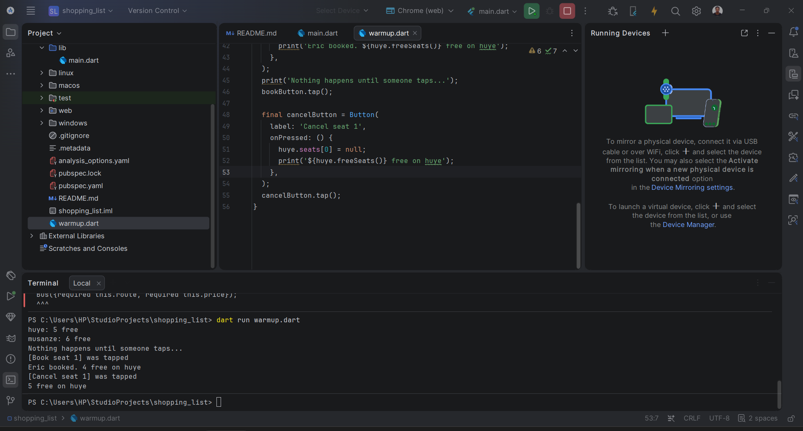
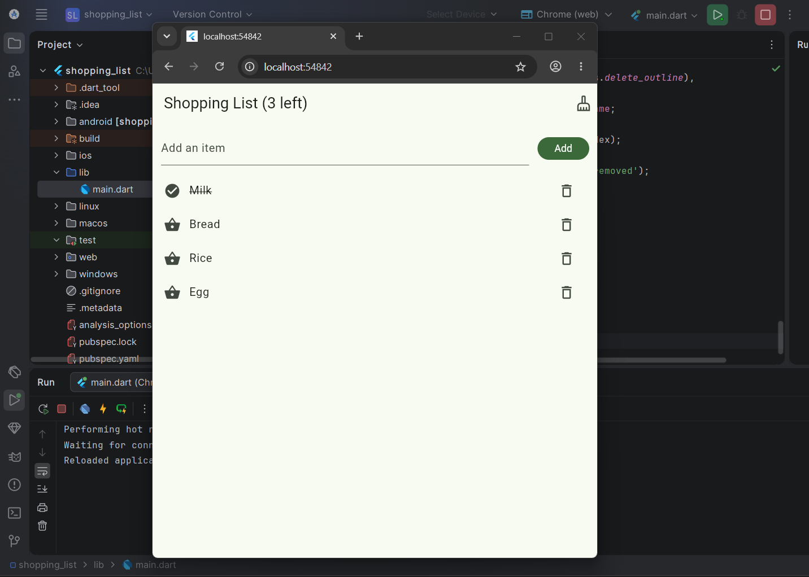
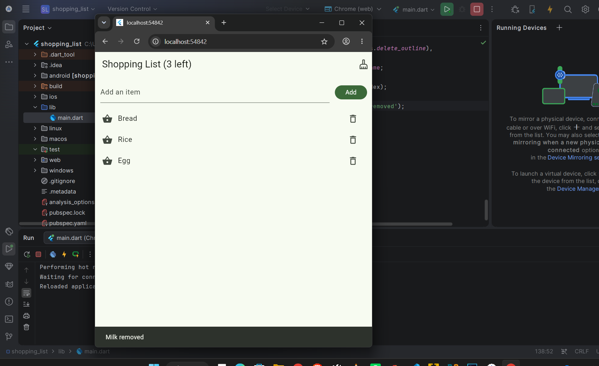

# Shopping List

My first Flutter app,Type an item, tap Add, tap an item when bought, delete it with the bin, and clear everything bought with the top bar button.

## Warm-up output

## Item added and one item marked as bought

## After clearing the bought items

